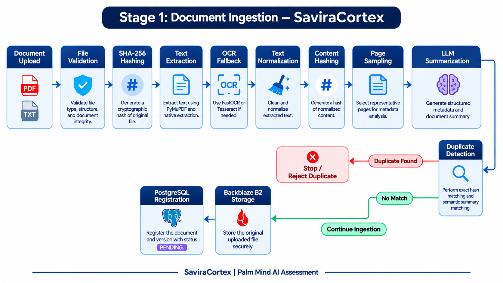
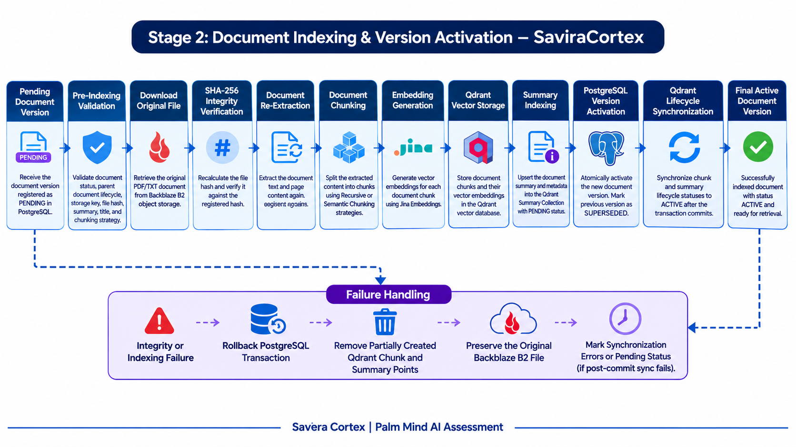
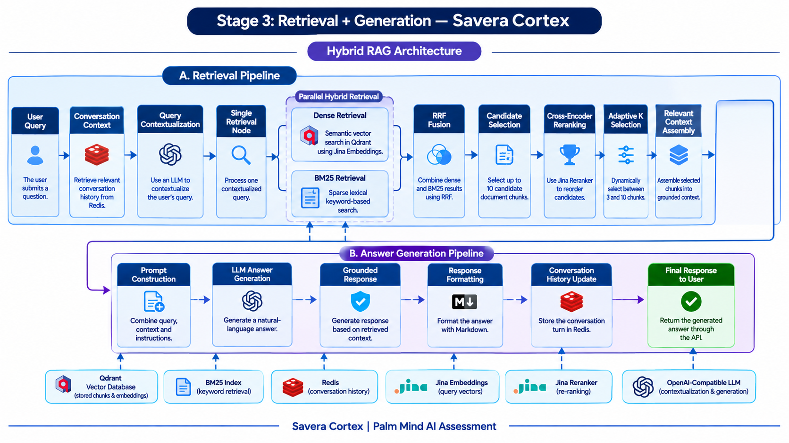

# SaviraCortex

**SaviraCortex** is a document-ingestion and retrieval-augmented conversational AI backend developed for the **Palm Mind AI assessment**.

It provides FastAPI endpoints for document ingestion, standard JSON chat, and Server-Sent Events (SSE) streaming chat. The backend uses a shared document catalogue, vector retrieval, hybrid BM25 + dense search, reranking, and Redis-backed conversation history.

## Two ways to use the API

### Option 1 — Quick start (use the hosted API)

No local installation is needed to try the deployed API.

- **Hosted API base URL:** https://palmmindai-assesment.onrender.com/
- **Swagger / interactive API docs:** https://palmmindai-assesment.onrender.com/docs
- **Health check:** https://palmmindai-assesment.onrender.com/health

The hosted API exposes these endpoints:

| Method | Endpoint | Purpose |
|---|---|---|
| `GET` | `/health` | Check API process health |
| `POST` | `/api/v1/documents/ingest` | Upload and index a PDF or TXT document |
| `POST` | `/api/v1/chat` | Send a message and receive a JSON answer |
| `POST` | `/api/v1/chat/stream` | Receive chat output as SSE events |
| `GET` | `/docs` | Interactive Swagger documentation |


#### Hosted API — curl examples (CMD)

**1. Health check**

```powershell
curl.exe "https://palmmindai-assesment.onrender.com/health"
```

**2. Ingest a PDF or TXT file**

Place a sample file in your current directory, then run:

```powershell
curl.exe -X POST "https://onrender.com" -F "file=@.\sample.pdf" -F "chunking_strategy=recursive"
```

For semantic chunking, use `chunking_strategy=semantic`. Supported strategies are `recursive` and `semantic`.

**3. Chat (JSON response)**

```powershell

curl.exe -X POST "https://palmmindai-assesment.onrender.com/api/v1/chat" -H "Content-Type: application/json" -d "{\"session_id\":\"assessment-session-001\",\"query\":\"Summarize the uploaded document.\"}"

```

Reuse the same `session_id` to continue the conversation. A different session ID starts a separate conversation.

**4. Chat (streaming SSE response)**

```powershell
curl.exe -X POST "https://palmmindai-assesment.onrender.com/api/v1/chat/stream" -H "Content-Type: application/json" -d "{\"session_id\":\"assessment-session-001\",\"query\":\"Explain the main ideas in the uploaded document.\"}"
```

The stream can emit `delta` events followed by a `completed` event. A route such as greeting or interview booking may complete without token-by-token deltas. Errors are sent as `error` events.

---

### Option 2 — Run the project locally (self-host)

Use this option to clone the repository, configure your own services and run the backend locally.

#### Requirements

- Python 3.11 or newer (the exact requirement is specified in `.python-version` / project metadata).
- [uv](https://docs.astral.sh/uv/)
- PostgreSQL, Redis, Qdrant, object storage, and configured embedding/LLM provider credentials as required by the backend.

#### 1. Clone the repository

```powershell
git clone https://github.com/miyasajid19/PalmMindAI-Assesment.git
cd PalmMindAI-Assesment
```

#### 2. Create and configure your environment file

Copy the example environment file. Populate the values locally; do not commit your `.env` file.

```powershell
Copy-Item .env.example .env
```

Open `.env` and configure the required database, Redis, Qdrant, storage, LLM/embedding, and OCR credentials. The names and descriptions of the variables are documented in the environment template. Keep secrets private.

#### 3. Install dependencies

Run these commands from the repository root:

```powershell
uv sync
```

#### 4. Start the API — Terminal 1

From the repository root:

```powershell
uv run uvicorn app.main:app --reload --host 127.0.0.1 --port 8000
```

Local API URLs:

- API base URL: `http://127.0.0.1:8000`
- Swagger docs: `http://127.0.0.1:8000/docs`
- Health check: `http://127.0.0.1:8000/health`

#### 5. Send requests — Terminal 2

Open a second PowerShell terminal and set the local base URL:

```powershell
$API_BASE_URL = "http://127.0.0.1:8000"
```

Use the same curl examples from the hosted Quick Start above. They will target your local API because `$API_BASE_URL` now points to localhost.

---

## Features

- PDF and TXT ingestion with validation, document registration, version lifecycle handling, and indexing.
- Recursive or semantic chunking, embeddings, and Qdrant vector storage.
- Hybrid retrieval combining BM25 and dense search with reciprocal rank fusion (RRF), reranking, and adaptive retrieval.
- Conversational RAG with Redis-backed session history.
- Interview-booking conversation routing.
- Standard JSON chat and SSE streaming chat endpoints.
- FastAPI interactive API documentation.

## Architecture diagrams

The main document and conversation flows are illustrated below.

### Stage 1 — Document ingestion



### Stage 2 — Document indexing and version activation



### Stage 3 — Retrieval and generation



## Conversation history

Conversation history is maintained in Redis under `conversation:{session_id}`. The default inactivity TTL is 30 minutes, and the default retained history is 10 turns. Configure these values using:

- `CONVERSATION_HISTORY_TTL_SECONDS` (default `1800`)
- `CONVERSATION_HISTORY_MAX_TURNS` (default `10`)
- `AIVEN_REDIS_URI` for Redis connectivity

A stable `session_id` maintains conversation continuity. A new session ID starts an independent conversation history.

## PDF OCR

PDF extraction is native-text-first. PyMuPDF extracts text, and pages below the configured `MIN_NATIVE_CHARS` threshold are sent to the selected OCR engine. FastOCR is the default hosted OCR provider (`OCR_ENGINE=fastocr`); set `FASTOCR_API_KEY` to enable it. Tesseract is available as an optional local alternative (`OCR_ENGINE=tesseract`) when its executable and language data are installed. Consider external OCR data-handling policies and provider costs.

## Utility scripts

Run these from the repository root:

```powershell
# Ingest a PDF locally through the utility pipeline
uv run python scripts/ingestion.py path/to/file.pdf

# Generate summary-based candidate documents
uv run python scripts/candidate_documents.py --query "question text"

# Search chunks with BM25
uv run python scripts/qdrant_bm25.py "question text"

# Inspect the Qdrant summary collection
uv run python scripts/qdrant_summary_store.py list
```

## Tests

```powershell
uv run pytest -q
```

Some integration tests may be skipped when sample files or external service prerequisites are unavailable.

## Interview booking

The conversation orchestrator routes interview-scheduling intents to the interview-booking dialogue instead of document retrieval. It gathers candidate name, email, date, and time, summarizes the details, and requires explicit confirmation before booking. Booking validation rejects past slots and persists confirmed bookings in PostgreSQL.

If the `interview_bookings` table already exists, apply the one-time migration at `app/core/migrations/20261107_add_interview_slot_unique.sql`. Review duplicate date/time entries before applying it; `create_tables()` creates missing tables but does not alter existing schemas.

## Assessment

This project was developed as the **Palm Mind AI assessment** submission.
